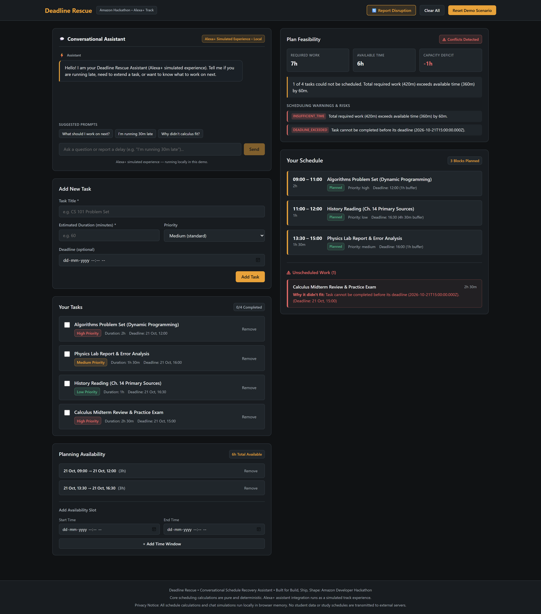

# Deadline Rescue — Student Deadline Recovery Assistant

> **Build, Ship, Shape: Amazon Developer Hackathon — Alexa+ Track**  
> **Track Simulation Disclosure:** *Deadline Rescue features an Alexa+ simulated experience running locally in browser memory. Core scheduling calculations are purely deterministic, transparent, and private. No live Alexa+ cloud endpoints or paid AI APIs are claimed or required.*

---



---

## 🎯 Problem Statement

When university students face crunch periods (such as midterm week), unexpected disruptions happen: a problem set takes an extra hour, an unexpected lab quiz is added, or a student gets delayed by traffic.

Traditional calendar apps and to-do lists fail in this moment:
- They silently allow deadlines to pass without notice.
- They naively stack overlapping events or generate mathematically impossible schedules.
- They lack conversational interfaces that let students quickly renegotiate their day while under stress.

## 💡 The Solution

**Deadline Rescue** is a conversational schedule recovery assistant. It pairs a **deterministic Earliest-Deadline-First (EDF) scheduling engine** with a **conversational Alexa+ assistant**:

1. **Deterministic & Honest:** The engine never hallucinates a feasible schedule. If a student has 3 hours available and 4 hours of work, it flags a 1-hour capacity deficit and explains exactly why the lowest-priority task could not be scheduled.
2. **Safe Replanning Workflow:** Reporting a delay or task extension produces a **candidate proposal** with a plan difference analysis. Active accepted schedules are **never overwritten** until the student reviews and explicitly clicks *Approve*.
3. **Conversational Disruption Intake:** Students can report delays naturally (*"I'm running 30 minutes late"*, *"My physics report will take another 45m"*, *"What should I work on next?"*) or use the manual modal fallback.

---

## 🏗️ Architecture & Technology Stack

- **Framework:** React 18 + Vite 6 + TypeScript (strict mode)
- **Styling:** CSS Modules with custom design tokens (dark focused workspace `#101214` with amber accent `#e8a23a`)
- **Testing:** Vitest 2.1 + React Testing Library (91 unit and UI integration tests)
- **Zero Secrets / Client-Side Safety:** Runs entirely offline with zero external network requests, protecting student study data and avoiding credentials exposure.

```
src/
├── app/
│   ├── App.tsx                    # Main app state machine & proposal lifecycle
│   └── App.module.css             # Responsive two-column layout & banners
├── components/
│   ├── ChatPanel.tsx              # Conversational assistant & simulated Alexa+ UI
│   ├── ScheduleTimeline.tsx       # Timeline blocks, risk badges & unscheduled list
│   ├── FeasibilityPanel.tsx       # Real-time capacity metrics & deficit tracking
│   ├── PlanDiff.tsx               # Before-and-after schedule comparison & decisions
│   ├── ReportDisruptionModal.tsx  # Structured manual reporting with quick pills
│   ├── TaskForm.tsx               # Validated task creation
│   ├── TaskList.tsx               # Task list with completion toggles & badges
│   └── AvailabilityEditor.tsx     # Work window editor & total available counter
├── features/
│   ├── assistant/                 # Intent parser, duration extractor & response logic
│   ├── planning/                  # Pure scheduler, feasibility, plan diff & replanning
│   └── tasks/                     # Task domain types & schema validation
└── lib/
    └── dateTime.ts                # Deterministic date-time math (ISO 8601 UTC)
```

---

## 🚀 Quick Start & Local Setup

### Prerequisites
- Node.js 18.0.0 or later (tested on Node v22.20.0)
- npm 9+ (or pnpm / yarn)

### Installation
```bash
# Clone the repository
git clone https://github.com/Hetk8406/Amazon-Hackathon---Deadline-Rescue.git
cd "Amazon-Hackathon---Deadline-Rescue"

# Install dependencies
npm install

# Run development server
npm run dev
```
Open [http://localhost:5173](http://localhost:5173) in your browser.

### Verification Commands
```bash
# Run all 91 unit and integration tests
npm test

# Verify TypeScript type compliance (zero errors)
npm run typecheck

# Build for production
npm run build
```

---

## 🎬 Demo Scenario & Video Script

A pre-loaded **"Midterm Crunch Week"** scenario is seeded by default:
- **Reference Time:** `08:30` (Oct 21, 2026)
- **Available Study Windows:** `09:00 - 12:00` (3h) and `13:30 - 16:30` (3h)
- **Workload:** 4 assignments totaling 420 minutes against 360 minutes of availability, generating a genuine 60-minute capacity deficit.

For the step-by-step video demonstration sequence, see:  
📖 **[docs/DEMO_SCRIPT.md](docs/DEMO_SCRIPT.md)**

---

## 🔒 Security & Privacy

- **No Secrets in Frontend:** The project requires no API keys, private tokens, or authentication credentials.
- **Data Privacy:** All task, schedule, and conversational messages are processed locally in browser memory.
- **Input Sanitization:** User inputs are validated with strict bounds (positive integers for durations, valid ISO timestamps, non-empty titles) before reaching scheduling functions.
- **XSS Protection:** Chat messages and task names are rendered safely using standard React text nodes without `dangerouslySetInnerHTML`.

---

## ⚠️ Known Limitations

1. **Single-Day Demo Horizon:** The current prototype focuses on a student's immediate crunch period (same-day or next-day windows).
2. **Fixed Interruptibility:** Tasks are currently scheduled as contiguous blocks rather than auto-fragmented across arbitrary 10-minute micro-breaks.
3. **Simulated Alexa+ Track:** When official Alexa+ developer APIs become publicly accessible, the conversational layer can be wired directly to live skill intents without modifying the deterministic scheduling engine.

---

## 📄 License

MIT License. Developed for the *Build, Ship, Shape: Amazon Developer Hackathon*.
